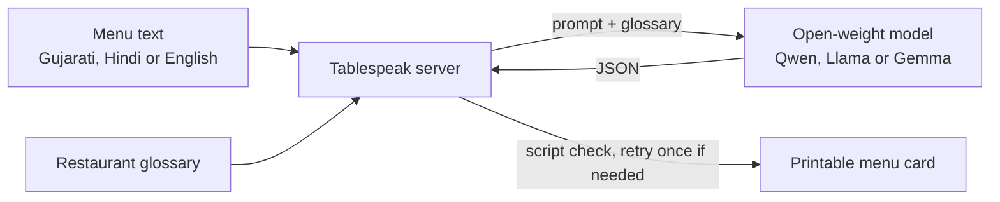

<div align="center">

# Tablespeak

**Translate a restaurant menu into any Indian language, and keep every dish spelled the way you serve it.**

[](https://tablespeak.vercel.app)
[](https://hacktoberfest.com)
[](#why-open-models)


<br>


<br>

## The problem

A generic translator guesses dish names. It turns *ઊંધિયું* into "mixed vegetable curry", spells *khaman* three different ways on one menu, and invents ingredients. For a restaurant that is proud of its food, that is the wrong menu to hand a tourist.

## The fix

Tablespeak gives the model the restaurant's own **glossary**, a dish dictionary the owner controls. Dishes in the glossary keep the exact spelling and description the owner chose, in every language. Everything else is translated normally.

```text
ઊંધિયું / undhiyu | Undhiyu | Surat's winter specialty: mixed vegetables slow-cooked with green masala
└─ as written on the menu   └─ preferred spelling   └─ description the model must use
```

Think of it as handing a freelance translator the restaurant's cookbook before they start.

## Features

| | |
|---|---|
| **Custom glossary** | Edit it in the app. Matching dishes get a turmeric dot on the card. Saved in your browser. |
| **10 languages** | English, Hindi, Gujarati, Marathi, Bengali, Tamil, Telugu, Kannada, Malayalam, Punjabi. |
| **Any input** | Gujarati or Hindi script, romanised Hinglish, English, or a mix. Prices are copied exactly as written. |
| **Wrong-script guard** | If a model answers in English for an Indian language, the server detects it and asks again. |
| **Printable card** | Copy the text, download a `.txt`, or print and save as PDF from the browser. |
| **Swap models** | A dropdown switches between open-weight models, so you can compare them on the same menu. |
| **Zero dependencies** | Plain HTML plus a small Node server. No framework, no build step. |

## How it works



The API key lives only on the server, so visitors never see it.

## Quick start

You need **Node 18+** and one API key from a provider that hosts open-weight models ([OpenRouter](https://openrouter.ai) works well).

```bash
git clone https://github.com/Jainil26/tablespeak.git
cd tablespeak
cp .env.example .env      # Windows: copy .env.example .env
# open .env and paste your key into LLM_API_KEY
npm start
```

Open **http://localhost:3000**, click **Use a sample menu**, then **Translate menu**. There is no `npm install` step.

## Deploy

[](https://vercel.com/new/clone?repository-url=https%3A%2F%2Fgithub.com%2FJainil26%2Ftablespeak&env=LLM_API_KEY,LLM_BASE_URL&envDescription=OpenRouter%20API%20key%20and%20base%20URL)

1. Import the repo in Vercel. No framework preset, no build command.
2. Add `LLM_API_KEY` and `LLM_BASE_URL` (`https://openrouter.ai/api/v1`).
3. Deploy. Set a spending limit on your key before you share the link.

## Why open models

- **Swap in one line.** Change the model list in `lib/config.js`, or set `LLM_MODELS`, and compare Qwen, Llama and Gemma on the same menu.
- **No lock-in.** Any OpenAI-compatible endpoint works. Change `LLM_BASE_URL` and nothing else.
- **Private when it matters.** Point the same code at a local [Ollama](https://ollama.com) server on a stronger machine, and menu data never leaves the building.
- **Cheap.** A menu is a few thousand tokens, so a translation costs very little, and open models are often the cheapest per token.
- **Yours to change.** The glossary and prompt are plain text, and open weights can be fine-tuned later for a specific cuisine.

### Providers

| Provider | `LLM_BASE_URL` |
|---|---|
| OpenRouter (default) | `https://openrouter.ai/api/v1` |
| Groq | `https://api.groq.com/openai/v1` |
| Together | `https://api.together.xyz/v1` |
| Hugging Face router | `https://router.huggingface.co/v1` |
| Ollama (local) | `http://localhost:11434/v1` with `LLM_API_KEY=ollama` |

Model ids change over time. Check your provider's model list if one returns an error.

## Configuration

| Variable | Purpose |
|---|---|
| `LLM_API_KEY` | Your provider key. Never commit `.env`. |
| `LLM_BASE_URL` | Any OpenAI-compatible endpoint. Defaults to OpenRouter. |
| `LLM_MODELS` | Optional dropdown override: `model-id=Label,model-id-2=Label 2`. The first is the default. |
| `LLM_JSON_MODE` | Set to `1` if your provider supports JSON mode. |

## Project layout

```text
public/index.html     the whole front end (HTML, CSS, JS)
public/glossary.txt   starter glossary of Gujarati dishes
lib/translate.js      prompt, model call, JSON parsing, script check and retry
lib/config.js         languages and model list
lib/handlers.js       request handling and a simple rate limit
api/                  Vercel serverless functions
server.js             local dev server, no dependencies
```

## Limitations

- Output is AI-generated. **Check ingredients and allergens before printing.**
- Open models are stronger in Hindi, Gujarati, Marathi and Bengali than in Malayalam, Kannada or Telugu. Compare models for your language.
- The rate limit is in memory and best effort. Cap your API spend if the site is public.

## Contributing

Contributions are welcome, and the repo is open for Hacktoberfest. Good first issues:

- [ ] Add a glossary starter pack for another cuisine (Punjabi, South Indian, Bengali, Rajasthani)
- [ ] Add more languages, such as Odia, Assamese or Urdu
- [ ] Upload a menu as a photo or PDF and extract the text first
- [ ] Add automated tests for `lib/translate.js`
- [ ] Import and export the glossary as CSV
- [ ] Add a dark-text print stylesheet for black-and-white printers

Open an issue to discuss your idea, then send a pull request.

## License

[MIT](LICENSE). Built by [@Jainil26](https://github.com/Jainil26) for the Hacktoberfest 2026 open-source AI challenge, Side Hustle theme.
